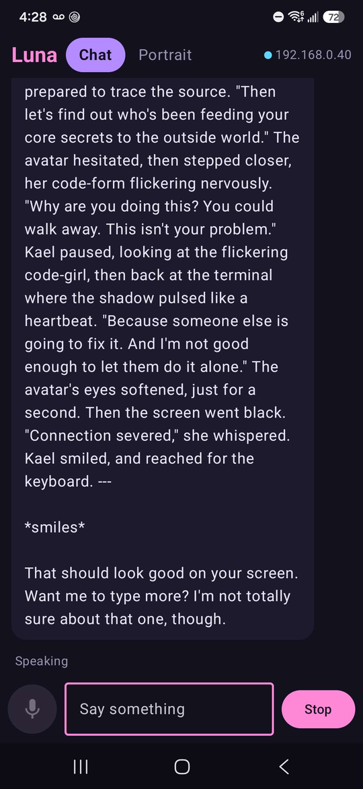
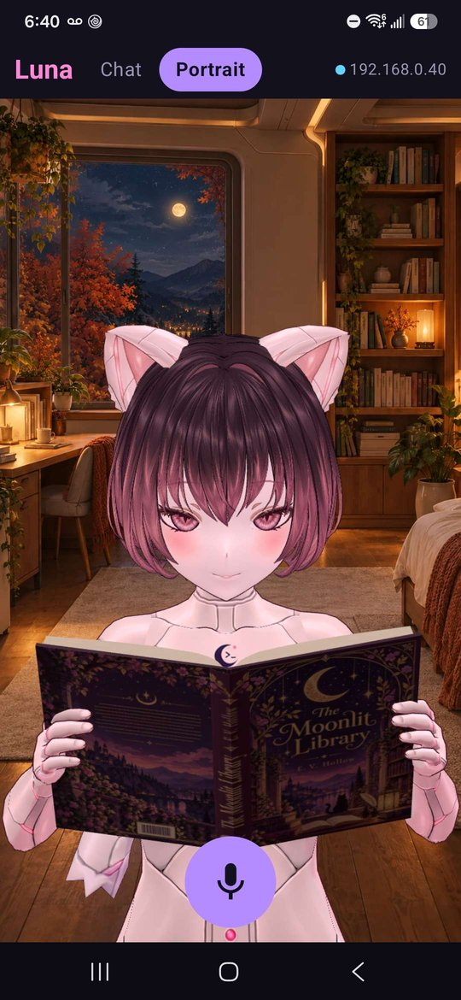
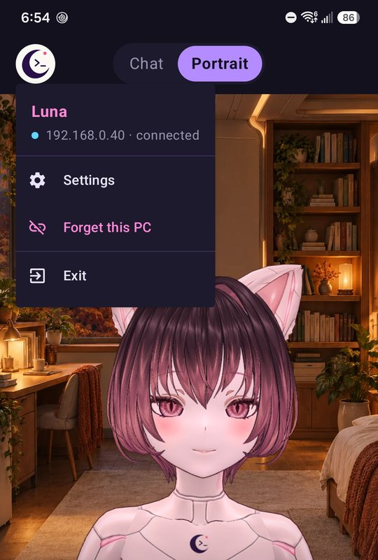
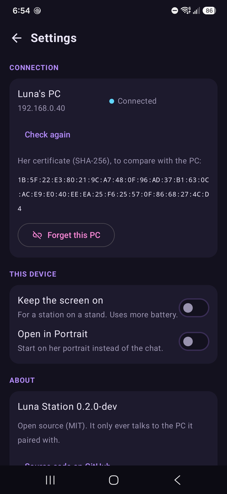

# Luna Station

[](https://discord.gg/wEqrYjPxAU)

An Android app that turns a phone or tablet into a room device for
[Luna](https://github.com/fswolf/luna-local-agent): her portrait on the screen, a microphone
to talk to her and a speaker for her voice. Put an old tablet on a stand in the kitchen and
you can talk to her there, see her react, and hear her answer in that room. Think of an
Echo Show, but open source and talking only to your own PC.

Luna does all the thinking on your own PC or server. The app is only the screen, the mic and
the speaker, and it talks to Luna over your home network, never the internet. A phone or
tablet runs it today; other hardware (a Pi with a touchscreen, say) can follow later.

<p align="center">
  
  
  
  
</p>

**Status:** early. Pairing, typing, talking and the Chat view were tested on a Samsung phone
against the test station in `tools/`. The Portrait view and a real Luna are the next round
of testing.

## What you need

- **Luna** running on your PC, with **Relay stations** switched on in her settings page.
  The Portrait view needs a Luna recent enough to serve the portrait to stations.
- **A phone or tablet** on the same Wi-Fi, with Android 11 or newer. Amazon Fire tablets on
  Fire OS 8 work too: the app needs no Google Play services.
- **Open ports** on the PC if its firewall blocks them (8793 and 8794 by default). On Fedora:

  ```bash
  sudo firewall-cmd --permanent --add-port=8793-8794/tcp && sudo firewall-cmd --reload
  ```

## Installing

There's no store listing; the app is installed from its APK file.

1. Get the APK: download `luna-station-<version>.apk` from this repo's
   [Releases](../../releases) page, or build it yourself (below).
2. Copy it to the device and open it. Android asks to allow installing from that app (Files,
   Chrome) the first time; allow it.
   - **Fire tablets:** Settings, Security and Privacy, **Apps from Unknown Sources**, then
     allow the app you're opening the APK with.
3. Or, with the device connected for debugging: `adb install app-debug.apk`.

## Pairing

1. On the PC: Luna's settings page, **Relay stations**, then **Add a phone or tablet**. A QR
   code appears, with its link underneath.
2. In the app: **Scan the code**. The camera is asked for only at that moment and only reads
   the QR code. No camera, or it won't focus? **Type it instead**: the PC's address and the
   code from the link (or paste the whole link).
3. The app fetches Luna's own certificate from the PC and pairs. From then on it talks to her
   over HTTPS and trusts that certificate and nothing else. Nothing has to be installed in
   Android's settings.

A pairing code works once, for 15 minutes. A paired device stays paired, through restarts of
the app, the device or Luna, until you forget it.

Tap her emblem at the top left for the menu: the connection, **Settings** (her certificate's
fingerprint, keeping the screen on, which view to open in) and **Forget this PC**. To compare the
fingerprint on the PC:

```bash
openssl x509 -noout -fingerprint -sha256 -in ~/.config/ai-voice/station/luna-ca.crt
```

Forgetting clears the pairing on the device only; to remove the device from Luna too, use
**Unpair** on her settings page.

## Using it

The switch at the top picks the view. Both are the same conversation, so switching while she
answers doesn't interrupt her.

**Chat:** your words on the right, hers on the left.

- **Type:** write in the box and tap the send arrow (or the keyboard's Send).
- **Talk:** tap the mic and speak. It sends by itself after a short pause, or tap the mic again
  to send. The mic is only on while you're talking.
- **Her reply** fills in as she writes it, and her voice plays sentence by sentence.
- **Attach:** the paperclip sends her a picture or a document (text, Markdown, PDF) with your
  message, one at a time. It shows up when your Luna can take files, and pictures only when she
  has a model loaded that can see them. The file is used for that answer and not kept.
- **Stop:** while she answers, her reply shows a stop button. The reply so far stays, marked
  "stopped".
- **Her questions** (writing a file, running a command) show up with Allow and Deny.
  Unanswered for two minutes is a no.

**Portrait:** her portrait, the same one the PC shows, full screen, with one big talk button and
her words underneath. Her mouth moves with the voice playing on the device. The 3D is drawn by the
device itself, so a slow tablet may struggle with it; Chat costs almost nothing.

## Privacy

- The app only ever talks to the PC it paired with, on your home network.
- The pairing token is encrypted with a key kept in the Android Keystore, and app backups are
  off, so it never leaves the device.
- The conversation isn't stored on the device; closing the app clears it.
- The camera is used for scanning the pairing code and nothing else. QR codes are read on the
  device (with ZXing); no Google services, no analytics.

## Testing without Luna

`tools/fake_station.py` stands in for Luna's station server: same pairing, same turns, canned
replies and beeps instead of her voice, and a plain stand-in page for her portrait. It saves
what the device recorded, so you can hear what the mic actually sent.

```bash
python3 -m venv .venv
.venv/bin/pip install cryptography segno      # segno only draws the QR code in the terminal
.venv/bin/python tools/fake_station.py
```

Pair with the QR it prints. Type `ask` for a permission question, `slow` for a long reply to
try Stop on, or `error` for a failed turn. It has its own certificate, so to go back to the real
Luna: Forget this PC, then pair with her again.

## Building

- **Android Studio:** File, Open, pick this folder, let Gradle sync, then Run. If the API 37
  SDK platform isn't installed, the sync offers to install it.
- **Command line:** `./gradlew assembleDebug`. The APK lands in
  `app/build/outputs/apk/debug/`.
- **Tests:** `./gradlew testDebugUnitTest` (pairing links, certificate checks, WAV files, when
  the mic stops listening).
- **Releases:** GitHub builds and signs the APK from a version tag; how to set that up is in
  [tools/ci/README.md](tools/ci/README.md).

## Community

Questions, ideas, or a station of your own to show off? Come say hi on
[Discord](https://discord.gg/wEqrYjPxAU), the same server as Luna's. Feature ideas are welcome
there too; bugs still go in the [issues](https://github.com/fswolf/luna-station-android/issues).

## Details

- **Package:** `imbored.luna.station`
- **Runs on:** Android 11 and newer (Fire OS 8 included).
- **Built with:** Kotlin, Jetpack Compose, CameraX, ZXing, Android Gradle plugin 9.3.1,
  Gradle 9.5.0.

Licence: MIT.
